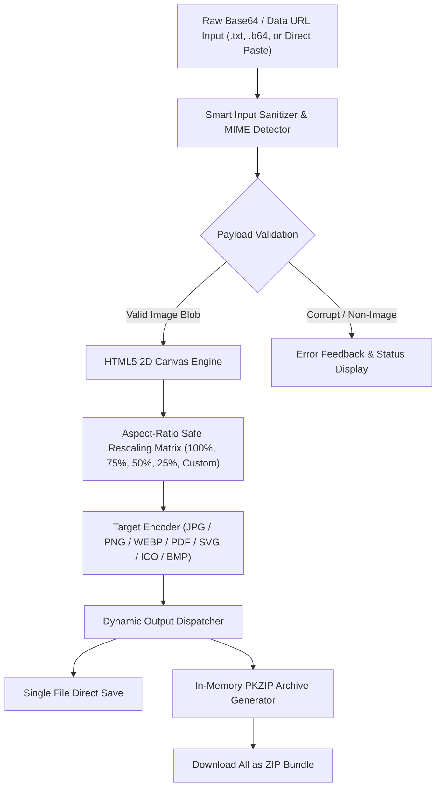

<div align="center">

# ⚡ Base64 Image Studio

### Enterprise-Grade, 100% Client-Side Base64 Image Decoding & Multi-Format Converter Suite

[](LICENSE)
[](.github/PULL_REQUEST_TEMPLATE.md)
[](#-data-privacy--security-guarantee)
[](https://www.spmanchester.com)

**[Explore Live Demo](https://serviceprovidermanchester.github.io/base64-image-studio/)** · **[Report Bug](https://github.com/serviceprovidermanchester/base64-image-studio/issues)** · **[Request Feature](https://github.com/serviceprovidermanchester/base64-image-studio/issues)**

</div>

---

> ### Built with ❤️ by [SPManchester Private Limited](https://www.spmanchester.com)
> **SPManchester Private Limited** develops modern enterprise software, cloud-native infrastructure, and high-performance open-source tools for engineering teams worldwide.

---

## 📌 Problem & Solution Overview

In modern web development, cybersecurity investigations, and API engineering, images are frequently encoded as **Base64 strings** or embedded in JSON payloads as **RFC 2397 Data URLs**. 

Most online Base64-to-image converters upload user payloads to remote web servers for conversion. This creates significant data leakage risks for confidential assets, proprietary screenshots, medical scans, or customer data.

**Base64 Image Studio** solves this problem by performing 100% of the decoding, scaling, and re-encoding **locally inside the client's web browser**:
- **Zero Remote Latency**: Native decoding speed powered by HTML5 Canvas and Web APIs.
- **Strict Data Confidentiality**: Files and memory buffers never leave your machine.
- **Enterprise Multi-Format Output**: Dynamic export to JPG, PNG, WEBP, PDF, SVG, ICO, and BMP.

---

## 🏗️ System Architecture



---

## 🚀 Key Features

- **🛡️ 100% Client-Side Privacy**: No backend servers, external APIs, tracking pixels, or data collection. Full GDPR, HIPAA, and corporate confidentiality compliance.
- **🔄 Dual Parsing Engine**: Seamlessly parses both full RFC 2397 data URLs (`data:image/png;base64,...`) and raw, un-prefixed Base64 strings by inspecting binary magic bytes.
- **🎨 Multi-Format Encoding**:
  - **JPG / JPEG**: Adjustable compression quality slider (30% to 100%) with white background rendering.
  - **PNG**: Lossless output preserving full 32-bit alpha transparency.
  - **WEBP**: Next-generation web format with high compression efficiency.
  - **PDF**: Standalone vector print container generated on-the-fly.
  - **SVG**: Embedded vector container wrapper.
  - **ICO**: Scaled 256×256 Windows application icon/favicon format.
  - **BMP**: Uncompressed 24-bit bitmap graphic.
- **📦 In-Memory Batch Packaging**: Real-time batch queue processing with standalone CRC-32 PKZIP compilation directly in browser memory.
- **📐 Aspect-Ratio Safe Rescaling**: Scale images down to 75%, 50%, 25%, or specify exact custom widths up to 16,000 pixels with automatic height synchronization.

---

## 💻 Tech Stack

| Layer | Technology | Purpose |
| :--- | :--- | :--- |
| **User Interface** | HTML5 Semantic Elements + Modern CSS3 | Ultra-fast dark-themed responsive layout with zero UI framework overhead |
| **Logic Engine** | Vanilla ECMAScript (ES6+) | Native browser execution without bundler or transpile lag |
| **Graphics API** | HTML5 Canvas 2D Rendering Context | Hardware-accelerated image decoding, rasterization, and pixel manipulation |
| **Packaging** | TypedArrays (`Uint8Array`, `DataView`) | Standalone RFC 1951 / PKZIP compliant in-memory archive generation |
| **Deployment** | GitHub Actions & GitHub Pages | Continuous integration and zero-configuration static site hosting |

---

## ⚡ Quick Start Guide

### Prerequisites
- Any modern web browser (Google Chrome, Mozilla Firefox, Apple Safari, Microsoft Edge).
- Optional: Node.js (for local development server).

### Local Installation & Execution

```bash
# 1. Clone the repository
git clone https://github.com/serviceprovidermanchester/base64-image-studio.git

# 2. Enter repository directory
cd base64-image-studio

# 3. Start local server using npm
npm start

# Alternatively, using Python
python -m http.server 3000
```

Once running, navigate to `http://localhost:3000` in your web browser.

---

## 📖 Usage Workflow

1. **Add Base64 Source**:
   - Drag and drop `.txt` or `.b64` files into the upload dropzone.
   - Or paste a raw Base64 string or data URL directly into the textarea and click **Add pasted data to queue**.
2. **Configure Output**:
   - Select your desired **Target Format** (JPG, PNG, WEBP, PDF, SVG, ICO, BMP).
   - Choose image scaling (Keep original, 75%, 50%, 25%, or Custom Width).
   - Adjust the **Compression Quality** slider if converting to lossy formats (JPG, WEBP).
3. **Convert & Export**:
   - Click **Convert to [FORMAT]**.
   - Save converted images individually using **Save File ↓**, or download the entire batch as an uncompressed archive with **Download All as ZIP Archive ↓**.

---

## 🔒 Data Privacy & Security Guarantee

Because **Base64 Image Studio** runs exclusively within your browser runtime:
- **No Telemetry**: No third-party analytics, user tracking, or remote error logging.
- **No Data Retention**: Image payloads are converted in transient browser memory and purged when cleared.
- **Offline Capable**: Functions seamlessly without an active internet connection once loaded.

For vulnerability disclosure or security inquiries, please consult [SECURITY.md](SECURITY.md) or contact our security desk at `info@spmanchester.com`.

---

## 🗺️ Roadmap & Future Enhancements

- [x] Multi-format target selection (JPG, PNG, WEBP, PDF, SVG, ICO, BMP).
- [x] In-memory PKZIP archive compilation.
- [x] Direct paste parsing with automatic binary magic-byte detection.
- [ ] Dedicated Web Worker thread pool for multi-file processing concurrency.
- [ ] Direct Image-to-Base64 two-way encoding studio.
- [ ] Published npm CLI package (`npx base64-image-studio`).

---

## 🤝 Contributing

Contributions, issues, and feature requests are welcome!  
Please review our [CONTRIBUTING.md](.github/PULL_REQUEST_TEMPLATE.md) guidelines before submitting a pull request.

---

## 🏢 About SPManchester Private Limited

**SPManchester Private Limited** is an IT solutions provider specializing in:
- High-Performance Cloud Architecture
- Bespoke Web & Enterprise Application Engineering
- Open-Source Developer Tools & Automation

- **Official Website**: [https://www.spmanchester.com](https://www.spmanchester.com)
- **Corporate Inquiries**: [info@spmanchester.com](mailto:info@spmanchester.com)
- **Lead Maintainer**: **Sayed Mudassar Akbar**

---

## 📄 License

This project is licensed under the **[MIT License](LICENSE)**.  
Copyright © 2026 **SPManchester Private Limited**. All rights reserved.
